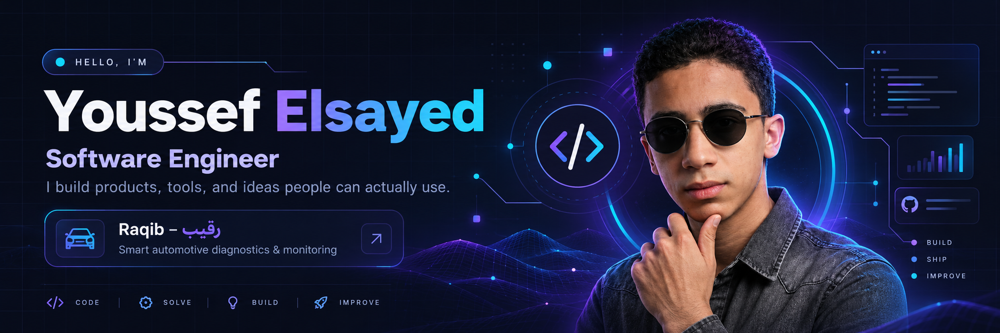

  

   

  
  
  

    
  <strong>Building products. Solving problems. Always learning.</strong>
   
  Web development • Software engineering • System design

---

### 👨‍💻 About me

I'm **Youssef Elsayed**, a software engineer who enjoys transforming ideas into practical, thoughtfully built digital products. I like working across the stack, experimenting with new technologies, and learning by shipping real projects.

- 🚀 **Currently building:** [Raqib — رقيب](https://raqib-eg.tech/), a smart vehicle diagnostics project.
- 💻 **Interested in:** Modern web apps, backend systems, developer tools, and system design.
- 🌱 **Currently exploring:** React, Next.js, PHP, Rust, Python, and Docker.
- 🤝 **Open to:** Open-source contributions and interesting collaborations.
- 💬 **Ask me about:** React and system design.

### ✨ Featured project

<table>
  <tr>
    <td width="100%">
      <h3>🛡️ Raqib — رقيب</h3>
      
A smart automotive diagnostics project, focused on making vehicle insights easier to access and understand.

      
    </td>
  </tr>
</table>

### 🧰 Languages & tools

  

### 📊 GitHub at a glance

  
  

These cards are generated by an external service and may occasionally be unavailable. Language percentages describe GitHub repository code, not overall experience.

### 🌐 Connect with me

  
  
  

    
  

    
  Thanks for stopping by! ✦ Keep building.

